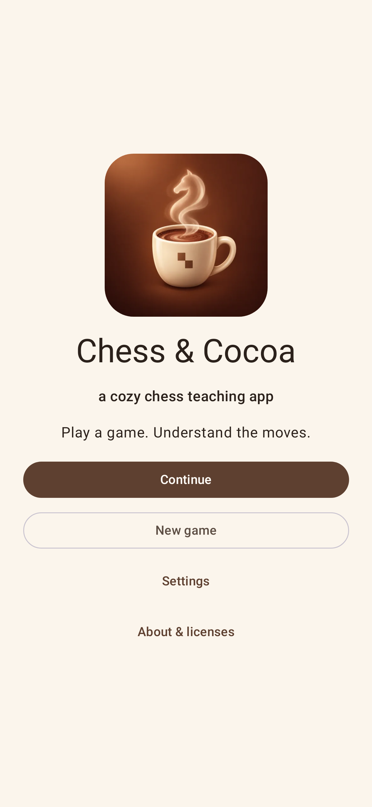
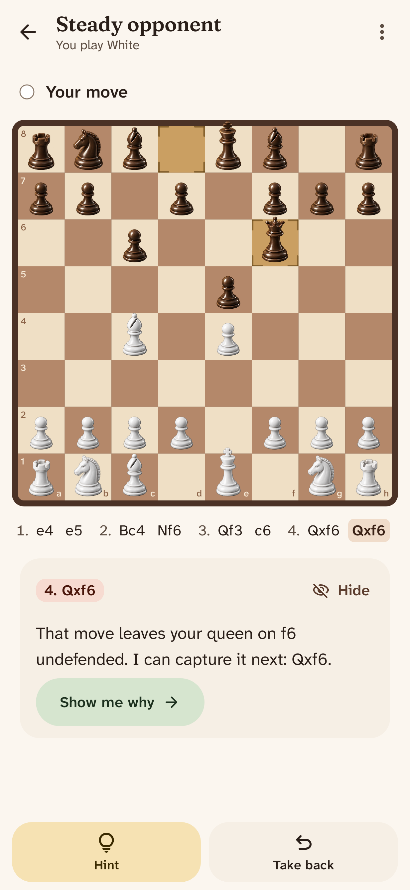
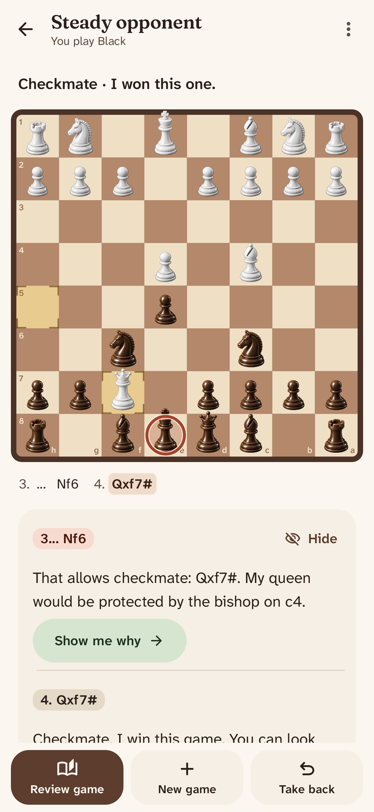

# Chess & Cocoa

> [!IMPORTANT]
> LLM disclosure: This codebase was written with substantial help from large language models: AI coding agents working from the [`AGENTS.md`](AGENTS.md) brief in this repo.

**Latest release:** v<!-- version -->0.2.1<!-- /version --> · [Download](https://github.com/L-K-M/ChessAndCocoa/releases/latest)

*A cozy chess teaching app for Android.* Play a game. Understand the moves.

The computer opponent pursues explicit, testable plans: attacking a square only your king defends, winning a weak piece, escorting a passed pawn, or using an open file to reach a pawn. It records each intention before you reply, and after your move tells you how your move affected it: whether you stopped the plan, only delayed it, or let it through. An independent Stockfish analysis judges the quality of every move separately, so stopping a plan never makes a bad move look good.

| Home | Feedback on a move | Game over |
|---|---|---|
|  |  |  |

## What it does

- **Untimed games** against three opponents: Gentle, Steady and Keen. No clock, no streaks, no nagging.
- **One calm point per move**, with "Show me why" to replay the evidence on a separate board.
- **Honest intentions**: the opponent reveals its plan only after your move touched it, and never claims a trap it did not record beforehand.
- **Hints on request**, in three steps (the threat, the idea, a move). Moves after a hint are marked as assisted.
- **Takebacks, save and resume**, with the opponent's recorded plans restored exactly.
- **A short review** of the game's plan episodes, key moments, and any easier moves the opponent chose on purpose.
- **Fully offline**. Stockfish 19 runs inside the app.

## Building

Requirements: JDK 17 or newer, the Android SDK with NDK 28.2 and CMake 3.22 (versions in [`gradle/libs.versions.toml`](gradle/libs.versions.toml)).

```sh
scripts/build.sh            # release APK (arm64) into dist/
scripts/build.sh --debug    # debug APK (arm64 + x86_64 for the emulator)
```

The first build downloads Stockfish's ~100 MB network and verifies it by hash ([`scripts/fetch-nnue.sh`](scripts/fetch-nnue.sh)). Tests and the research harness use a desktop Stockfish built from the same vendored sources:

```sh
scripts/build-stockfish-host.sh
./gradlew test testDebugUnitTest lintDebug
./gradlew :harness:run --args="--games 12 --difficulty STEADY"
```

## Documents

- [`chess_and_cocoa_concept.md`](chess_and_cocoa_concept.md): the product concept and design brief.
- [`chess_and_cocoa_concept_review.md`](chess_and_cocoa_concept_review.md): the independent review it was revised against.
- [`docs/DESIGN.md`](docs/DESIGN.md): how the code implements the brief, with requirement traceability.
- [`docs/experiments/`](docs/experiments/2026-10-16-gentle-calibration.md): results of the decision experiments and difficulty checks.

## License

Chess & Cocoa is free software under the GNU General Public License, version 3 or later; see [LICENSE](LICENSE). It includes Stockfish 19 (GPL-3.0-or-later, [`third_party/stockfish/`](third_party/stockfish/PROVENANCE.md)), whose network was trained on Leela Chess Zero data under the Open Database License, and the cburnett chess pieces (GPL-2.0-or-later). Full notices: [`legal/THIRD_PARTY_NOTICES.md`](legal/THIRD_PARTY_NOTICES.md).
